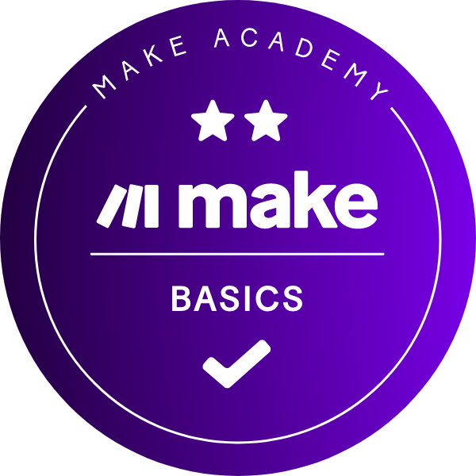

## Hi, ich bin Jay Imdahl

Softwareentwickler & Informatikkaufmann aus Tübingen. Ich entwickle **plattformübergreifende Desktop-Apps (Flutter/Dart)**, **Python-Backends (Django)** und **n8n-Automatisierungen** – von sauberer Architektur bis zum fertigen Release.

**Aktuell:** Offen für Festanstellung & Projekte (Remote / Tübingen–Stuttgart)  
[Portfolio (jayimdahl.de)](https://jayimdahl.de) · [Speechius](https://speechius.com/de/) · [LinkedIn](https://www.linkedin.com/in/jayimdahl/) · [YouTube: SyntacOps (EN · 8k+)](https://www.youtube.com/c/SyntacOps) · [Binärverkehr (DE · 3k+)](https://www.youtube.com/@binaerverkehr)

---

### Projekte, Kurs & Kundenfeedback

<table>
  <tr>
    <td width="205" valign="top">
      
    </td>
    <td width="435" valign="top">
      <strong><a href="https://speechius.com/de/">Speechius – Desktop-Teleprompter (macOS &amp; Windows)</a></strong> <em>(Closed Source)</em>  
      Teleprompter mit lokaler Spracherkennung, der Skripte Wort für Wort synchron zum eigenen Sprechtempo mitführt – mit Capture-Ausschluss für Zoom, Google Meet, Microsoft Teams &amp; OBS.  
      <strong>Stack:</strong> Flutter · Dart · Riverpod · Drift (SQLite) · Vosk &amp; Apple Speech
    </td>
  </tr>
  <tr>
    <td width="205" valign="top">
      
    </td>
    <td width="435" valign="top">
      <strong><a href="https://www.udemy.com/course/flutter-clean-architecture/">Udemy-Kurs: Flutter Clean Architecture</a></strong> · ⭐ 4,7 <em>(Highest Rated · 37 Bewertungen · 231 Teilnehmende)</em>  
      Praxiskurs zu Clean Architecture, SOLID-Prinzipien und sauberer Schichten-Trennung (Domain, Data, Presentation) mit Riverpod, freezed &amp; Isar.  
      <strong>Begleitcode:</strong> <a href="https://github.com/binaerverkehr/flutter_flashcards_demo">flutter_flashcards_demo</a>
    </td>
  </tr>
  <tr>
    <td width="205" valign="top">
      
    </td>
    <td width="435" valign="top">
      <strong><a href="https://jayimdahl.de">n8n-Automatisierung für Buchcover (Kundenauftrag)</a></strong> · ⭐ 5,0 auf Upwork  
      Automatisierter Workflow (n8n &amp; Google Drive API) zum Auslesen von Rohbildern und Metadaten sowie automatischen Zuschnitt und Textplatzierung.  
      <em>„He quickly understood the requirements, proposed smart solutions, and implemented them efficiently. Communication was clear and proactive throughout the process, and he always delivered on time.“</em>
    </td>
  </tr>
</table>

---

### Zertifizierungen

<table>
  <tr>
    <td align="center" width="210">
       
      <strong>PCAP (Python)</strong> 
      Python Institute · ID: <code>tD1F.1hOu.Q5cp</code>
    </td>
    <td align="center" width="210">
       
      <strong>n8n Level 2</strong> 
      n8n.io · Workflow-Automatisierung
    </td>
    <td align="center" width="210">
       
      <strong>Make Basics</strong> 
      Make Academy · Automatisierung
    </td>
  </tr>
</table>

---

### Schwerpunkte

- **Desktop & Apps:** Flutter, Dart, Riverpod, Drift (SQLite), Clean Architecture
- **Backend & Web:** Python, Django, REST-APIs, HTMX, Astro, TypeScript
- **Automatisierung & Ops:** n8n, Docker, Linux, Coolify, Git, Testing
- **Wissensvermittlung:** 11.000+ Abonnenten auf YouTube (EN & DE), Online-Kurse & Programmierunterricht
