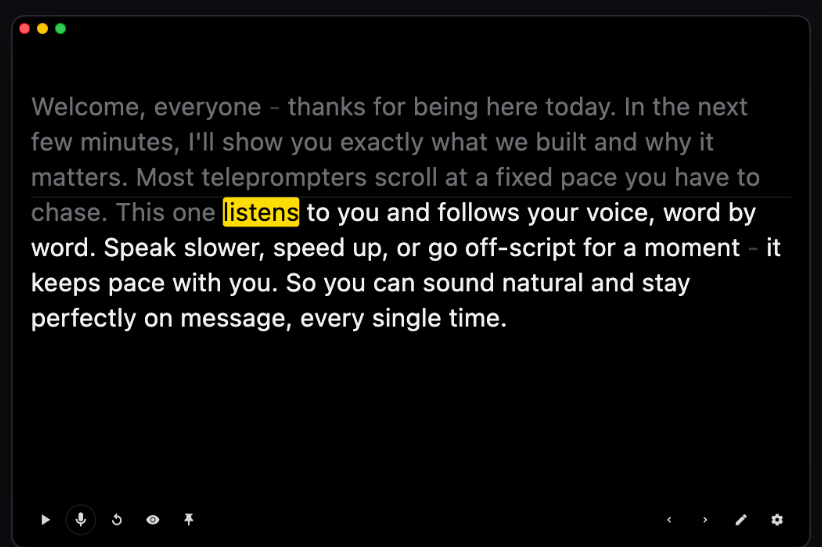

## Hi, ich bin Jay Imdahl

Softwareentwickler & Informatikkaufmann aus Tübingen. Ich entwickle **plattformübergreifende Desktop-Apps (Flutter/Dart)**, **Python-Backends (Django)** und **n8n-Automatisierungen** – von sauberer Architektur bis zum fertigen Release.

**Aktuell:** Offen für Festanstellung & Projekte (Remote / Tübingen–Stuttgart)  
[Portfolio (jayimdahl.de)](https://jayimdahl.de) · [Speechius](https://speechius.com/de/) · [LinkedIn](https://www.linkedin.com/in/jay-imdahl-78390517a/) · [YouTube: SyntacOps (EN · 8k+)](https://www.youtube.com/c/SyntacOps) · [Binärverkehr (DE · 3k+)](https://www.youtube.com/@binaerverkehr)

---

### Veröffentlichtes Produkt (Closed Source)

<table>
  <tr>
    <td width="240" valign="top">
      
    </td>
    <td valign="top">
      <strong><a href="https://speechius.com/de/">Speechius – Desktop-Teleprompter (macOS &amp; Windows)</a></strong>  
      Teleprompter mit lokaler Spracherkennung, der Skripte Wort für Wort synchron zum eigenen Sprechtempo mitführt – mit Capture-Ausschluss für Zoom, Google Meet, Microsoft Teams &amp; OBS.  
      <strong>Stack:</strong> Flutter · Dart · Riverpod · Drift (SQLite) · Vosk &amp; Apple Speech · macOS &amp; Windows Releases
    </td>
  </tr>
</table>

---

### Schwerpunkte & Zertifizierungen

- **Desktop & Apps:** Flutter, Dart, Riverpod, Drift (SQLite), Clean Architecture
- **Backend & Web:** Python, Django, REST-APIs, HTMX, Astro, TypeScript
- **Automatisierung & Ops:** n8n, Docker, Linux, Coolify, Git, Testing
- **Zertifizierungen:** PCAP *(Certified Associate in Python Programming)* · n8n Level 2 Certification
- **Wissensvermittlung:** 11.000+ Abonnenten auf YouTube (EN & DE), Online-Kurse & Programmierunterricht
