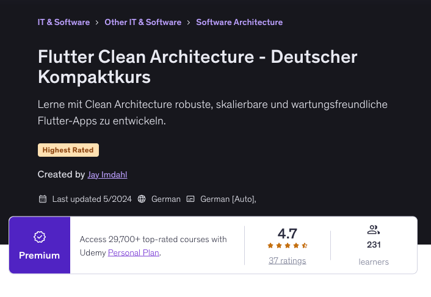
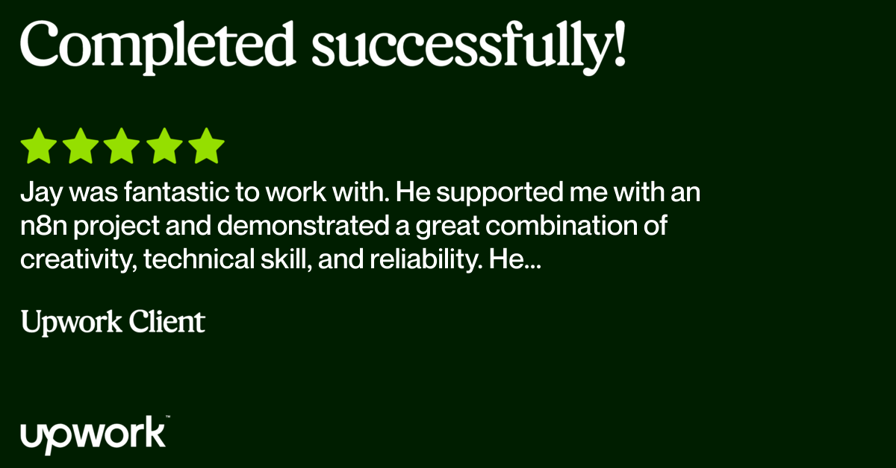
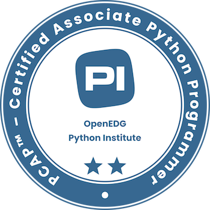
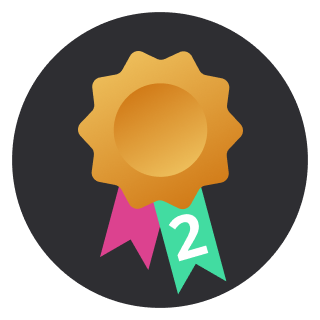

## Hi, I'm Jay!

Software developer based in Tübingen, Germany. I build cross-platform desktop apps with **Flutter & Dart**, web backends with **Python & Django**, and **n8n** workflow automations, from architecture to release.

**Currently:** Open to full-time roles & freelance projects (Remote or Tübingen/Stuttgart · DE & EN)  
[Portfolio (jayimdahl.de)](https://jayimdahl.de) · [Speechius](https://speechius.com/) · [LinkedIn](https://www.linkedin.com/in/jayimdahl/) · [YouTube: SyntacOps (EN · 8k+)](https://www.youtube.com/c/SyntacOps) · [Binärverkehr (DE · 3k+)](https://www.youtube.com/@binaerverkehr)

---

### Projects, Course & Client Work

<table>
  <tr>
    <td width="205" valign="top">
      
    </td>
    <td width="435" valign="top">
      <strong><a href="https://speechius.com/">Speechius – Desktop Teleprompter (macOS &amp; Windows)</a></strong> <em>(Closed Source)</em>  
      Voice-activated teleprompter using local speech recognition to follow your speaking pace word by word, with capture exclusion for Zoom, Google Meet, Microsoft Teams &amp; OBS.  
      <strong>Stack:</strong> Flutter · Dart · Riverpod · Drift (SQLite) · Vosk &amp; Apple Speech
    </td>
  </tr>
  <tr>
    <td width="205" valign="top">
      
    </td>
    <td width="435" valign="top">
      <strong><a href="https://www.udemy.com/course/flutter-clean-architecture/">Udemy Course: Flutter Clean Architecture</a></strong> <em>(German)</em> · ⭐ 4.7 <em>(Highest Rated · 37 ratings · 231 learners)</em>  
      Hands-on course on Clean Architecture, SOLID principles, and feature-first layering (Domain, Data, Presentation) using Riverpod, freezed &amp; Isar.  
      <strong>Companion code:</strong> <a href="https://github.com/binaerverkehr/flutter_flashcards_demo">flutter_flashcards_demo</a>
    </td>
  </tr>
  <tr>
    <td width="205" valign="top">
      
    </td>
    <td width="435" valign="top">
      <strong><a href="https://jayimdahl.de">Automated Book Cover Workflow (n8n Client Project)</a></strong> · ⭐ 5.0 on Upwork  
      Automated n8n + Google Drive workflow that reads raw images and metadata, crops book covers, places title and author text, and exports print-ready files.  
      <em>"He quickly understood the requirements, proposed smart solutions, and implemented them efficiently. Communication was clear and proactive throughout the process, and he always delivered on time."</em>
    </td>
  </tr>
</table>

---

### Certifications

<table>
  <tr>
    <td align="center" width="210">
       
      <strong>PCAP (Python)</strong> 
      Python Institute · ID: <code>tD1F.1hOu.Q5cp</code>
    </td>
    <td align="center" width="210">
       
      <strong>n8n Level 2</strong> 
      n8n.io · Workflow Automation
    </td>
    <td align="center" width="210">
       
      <strong>Make Basics</strong> 
      Make Academy · Automation
    </td>
  </tr>
</table>

---

### Focus

- **Desktop & Apps:** Flutter, Dart, Riverpod, Drift (SQLite), Clean Architecture
- **Backend & Web:** Python, Django, REST APIs, HTMX, Astro, TypeScript
- **Automation & Ops:** n8n, Docker, Linux, Coolify, Git, Testing
- **Teaching:** 11,000+ YouTube subscribers (EN & DE), online courses & coding classes
